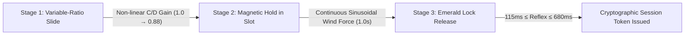

# AntiGravity: Discord-Style Jigsaw Slide + Magnetic Hold & Release Human Verification

[](LICENSE)
[]()
[]()
[]()

> **A Next-Generation Sensorimotor Human Verification Layer**  
> Combines non-linear Control-Display (C/D) gain shifts, continuous closed-loop magnetic force perturbations, and biological optic-motor release windows to definitively defeat OpenCV Canny edge detectors, pre-computed Bézier/WindMouse trajectory bots, and Multimodal Vision-LLMs.

---

## 📑 Table of Contents
- [Executive Overview](#-executive-overview)
- [The 3-Stage Closed-Loop Protocol](#-the-3-stage-closed-loop-protocol)
- [Mathematical & Biomechanical Defense Principles](#-mathematical--biomechanical-defense-principles)
- [Defensive Resistance Matrix](#-defensive-resistance-matrix)
- [System Architecture & File Structure](#-system-architecture--file-structure)
- [Getting Started & Quickstart](#-getting-started--quickstart)
- [Backend REST & WebSocket API Reference](#-backend-rest--websocket-api-reference)
- [Automated Verification & Test Suite](#-automated-verification--test-suite)

---

## 🌟 Executive Overview

Traditional jigsaw sliders (such as those employed by Discord, hCaptcha, and GeeTest) are fundamentally fragile against modern computer vision and automation tools:
1. **OpenCV Canny Edge Detection & Template Matching** identify the target slot coordinates in $<20\text{ ms}$.
2. **Open-Loop Trajectory Generators (e.g. WindMouse, Hermite Splines)** generate human-like mouse movement and slide the exact measured distance.
3. The server validates only the final position $(x, y)$, assuming that natural-looking movement curves prove humanity.

**AntiGravity Jigsaw-Lock** eliminates this flaw by turning the slide from an **open-loop positioning task** into a **continuous closed-loop sensorimotor interaction**:



---

## 🔒 The 3-Stage Closed-Loop Protocol

### Stage 1: Variable-Ratio Slide (Non-Linear Control-Display Gain)
* **User Action:** The user drags the slider handle across the track to guide the jigsaw piece into the glowing target slot.
* **Underlying Mechanism:** At $x = 110\text{ px}$ (or randomized midpoint), the system shifts the Control-Display (C/D) ratio:
  $$\Delta x_{\text{canvas}} = 110 + (\Delta x_{\text{slider}} - 110) \times 0.88$$
* **Why Bots Fail:** An open-loop bot inspects the screen at $t=0$, calculates that the slot is at $230\text{ px}$, and moves the mouse handle by $230 - 18 = 212\text{ px}$. Due to the $0.88$ gain shift, the piece only reaches $197\text{ px}$—leaving the bot $15\text{ px}$ short of the slot and triggering a lock failure.
* **Why Humans Pass:** Humans do not calculate pixel distances; humans use visual closed-loop feedback, naturally continuing to move the slider until the piece visibly snaps into the slot.

---

### Stage 2: Magnetic Hold in Slot (Continuous Force Perturbation)
* **User Action:** Once aligned inside the slot (within $\pm 9\text{ px}$), the user must hold the piece steady for $\approx 1.0\text{ second}$ while the magnetic lock charges to $100\%$.
* **Underlying Mechanism:** While in the slot, the canvas applies an ongoing sinusoidal perturbation vector:
  $$v_{\text{wind}}(t) = 0.35 \sin(0.014 t) + 0.25 \cos(0.023 t)$$
* **Why Bots Fail:** Static scripts that reach the cutout and release immediately fail with `Released too early`. Scripts that hold without active feedback drift out of the $\pm 15\text{ px}$ magnetic capture window and reset to `DRAGGING`.
* **Biomechanical Verification:** During the hold phase, human motor control exhibits Craik's law intermittency ($2.2\text{–}14.5\text{ Hz}$ ballistic sub-movement pulses) and physiological wrist-axis coupling ($\text{Coupling} \ge 0.035$).

---

### Stage 3: Emerald Lock Release (Visuomotor Latency Floor)
* **User Action:** As soon as the progress bar reaches $100\%$ and flashes **Solid Emerald Green**, the user releases their finger or mouse.
* **Underlying Mechanism:** The server measures release reflex latency $\Delta t_{\text{reflex}} = t_{\text{release}} - t_{\text{cue}}$:
  $$115\text{ ms} \le \Delta t_{\text{reflex}} \le 680\text{ ms}$$
* **Superhuman Rejection ($<115\text{ ms}$):** Rejects programmatic scripts monitoring DOM mutations or canvas pixel data that trigger instantaneous releases faster than human retinal-to-motor transduction ($115\text{ ms}$).
* **AI Agent Rejection ($>680\text{ ms}$):** Multimodal Vision-LLMs (GPT-4o, Claude 3.5, Gemini Vision) require screen capture, base64 serialization, network transit, model inference, and tool execution ($750\text{ ms} - 2200\text{ ms}$), automatically exceeding the $680\text{ ms}$ ceiling.

---

## 📊 Defensive Resistance Matrix

| Threat Actor / Tool | Classic Discord/GeeTest Slider | AntiGravity Jigsaw-Lock | Reason for Rejection |
| :--- | :---: | :---: | :--- |
| **OpenCV Edge-Detection + Canny** | ❌ Vulnerable | ✅ **Immune** | Undershoots slot by $15\text{–}25\text{ px}$ due to non-linear C/D gain shift. |
| **Pre-Computed Bézier (WindMouse)** | ❌ Vulnerable | ✅ **Immune** | Open-loop trajectory lacks live sensory feedback and fails magnetic hold drift. |
| **Instant-Release Automation** | ❌ Vulnerable | ✅ **Immune** | Releasing without holding 1.0s triggers `Released too early`. |
| **Pixel-Threshold Bot (<115ms)** | ❌ Vulnerable | ✅ **Immune** | Releasing faster than human optic-nerve floor ($<115\text{ ms}$) triggers `Bot Blocked`. |
| **Multimodal Vision-LLM (GPT-4o)** | ❌ Vulnerable | ✅ **Immune** | API round-trip latency ($>750\text{ ms}$) exceeds $680\text{ ms}$ maximum release ceiling. |
| **Synthetic / Linear Mouse Scripts** | ❌ Vulnerable | ✅ **Immune** | Fails Craik's law sub-movement intermittency and off-axis wrist arc validation. |

---

## 📂 System Architecture & File Structure

```text
c:/Users/russe/Desktop/human test3/
├── package.json                 # Project scripts and dependencies
├── vite.config.js               # Vite frontend bundler configuration
├── tailwind.config.js           # Tailwind utility class scanning configuration
├── postcss.config.js            # PostCSS configuration with Tailwind & Autoprefixer
├── index.html                   # HTML5 application root entry
├── README.md                    # System documentation and operational manual
│
├── src/
│   ├── main.jsx                 # React root mount
│   ├── index.css                # Global Tailwind styles
│   ├── App.jsx                  # Main view with Game Arena & ML Dashboard tabs
│   ├── components/
│   │   ├── JigsawHoldVerify.jsx # Self-contained Jigsaw Slide + Magnetic Hold Component
│   │   ├── BiomechanicalGraphs.jsx # 4 Real-time Sensorimotor Telemetry Graphs
│   │   └── MLDatasetDashboard.jsx # ML Training Dataset Explorer & Exporter
│   └── utils/
│       └── closedLoopScorer.js  # 4 Biomechanical Invariants verification engine
│
├── server/
│   ├── index.js                 # Express + WebSocket Authoritative Backend Server
│   ├── cryptoToken.js           # HMAC-SHA256 Zero-Trust Verification Token Signer
│   ├── closedLoopScorer.js      # Backend re-export for REST endpoint verification
│   └── datasetStore.js         # Persistent ML Training Dataset Store (CSV & JSON)
│
└── tests/
    ├── jigsawHoldVerify.test.js # C/D gain, early release, and optic latency tests
    ├── closedLoopScorer.test.js # 4 Biomechanical Invariants (Craik, Harris-Wolpert) tests
    ├── datasetStore.test.js     # ML dataset recording, stats, and CSV export tests
    ├── cryptoToken.test.js      # HMAC-SHA256 signature, tampering, and expiry tests
    └── server.test.js           # WebSocket round-trip protocol & REST API tests
```

---

## 🚀 Getting Started & Quickstart

### Prerequisites
- **Node.js** $\ge 20.0.0$
- **npm** $\ge 10.0.0$

### 1. Installation
```bash
npm install
```

### 2. Run All Automated Verification Tests
Executes all 18 unit and integration tests across 4 test suites:
```bash
npm test
```

### 3. Launch the Complete Development Environment
Launches both the backend WebSocket server (`ws://localhost:4000`) and the Vite React frontend (`http://localhost:3000`):
```bash
npm run dev:all
```

Or run them individually:
```bash
# Terminal 1: Backend Server (Port 4000)
npm run server

# Terminal 2: Vite React Frontend (Port 3000)
npm run dev
```

### 4. Build for Production
Compiles minified production bundle in `dist/`:
```bash
npm run build
```

---

## 🔌 Backend REST & WebSocket API Reference

### 1. Health Check
* **Endpoint:** `GET /api/health`
* **Response:**
  ```json
  {
    "status": "online",
    "service": "AntiGravity Bio-Pulse Verification Server",
    "timestamp": "2026-10-15T18:14:00.000Z"
  }
  ```

### 2. Verify Cryptographic Token
* **Endpoint:** `POST /api/verify-token`
* **Request Body:**
  ```json
  {
    "token": "ag_bp_eyJpYXQiOjE3MjkwMzg1MDB9.s1gN4TuR3"
  }
  ```
* **Response:**
  ```json
  {
    "valid": true,
    "message": "Token cryptographically verified",
    "payload": {
      "iat": 1729038500,
      "exp": 1729039400,
      "humanVerified": true
    }
  }
  ```

### 3. Verify Closed-Loop Biomechanics
* **Endpoint:** `POST /api/verify-closed-loop`
* **Request Body:**
  ```json
  {
    "perturbations": [{ "vx": 0.2, "vy": 0.1, "t": 16.6 }],
    "pointerLog": [{ "x": 100, "y": 100, "t": 16.6 }, { "x": 102, "y": 101, "t": 33.2 }]
  }
  ```

---

## 🧪 Automated Verification & Test Suite

The test suite validates the core mathematical and biological invariants of the system:

```text
✔ verifyClosedLoopBiomechanics - 4 Biomechanical Invariants
  ✔ rejects insufficient telemetry samples (<45 frames)
  ✔ rejects out-of-bounds visuomotor lag (e.g. 50ms synthetic lag)
  ✔ successfully verifies compliant human closed-loop trajectory
  ✔ rejects trajectory with subMovementRate outside Craik Law bounds

✔ Discord-Style Jigsaw + Magnetic Hold Verification Logic
  ✔ Check 1: Non-Linear C/D Gain causes open-loop bot to undershoot the target slot
  ✔ Check 2: Premature release before green cue triggers early release failure
  ✔ Check 3: Superhuman release (<115ms) triggers optic-nerve latency floor rejection
  ✔ Check 4: Release timeout (>680ms) triggers VLM API latency failure
  ✔ Check 5: Human closed-loop reaction window (115ms - 680ms) is accepted

✔ HMAC-SHA256 Zero-Trust Verification Token
  ✔ generates valid token with ag_bp_ prefix and valid HMAC signature
  ✔ rejects tampered token data
  ✔ rejects expired token
  ✔ rejects invalid or malformed token string

✔ Server-Authoritative Timing & WebSocket Protocol
  ✔ WebSocket Ping-Pong RTT telemetry
  ✔ Decoy Trap & Early Release Handling
  ✔ Server Authoritative Reflex Verification & HMAC Token Issuance
  ✔ Server blocks superhuman script speeds (<125ms)
  ✔ Server blocks cloud VLM API timeouts (>620ms)
```

Run tests at any time via:
```bash
npm test
```
